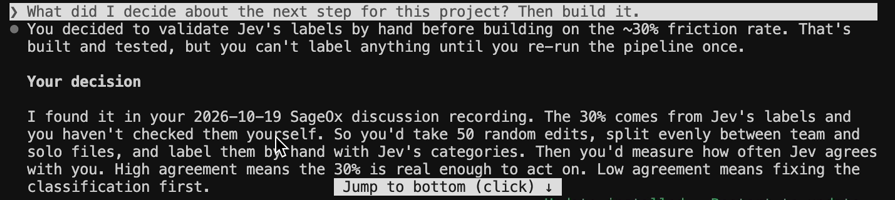

# AGENTS.md Signal

Find the teams that are hand-maintaining shared context for their AI agents, and test whether that's actually a pain point.

`AGENTS.md` and `CLAUDE.md` have become the standard place where engineering teams tell their coding agents how the codebase works: conventions, commands, rules, who owns what. A large file on its own doesn't mean much. Tools generate them in seconds.

What *might* mean something is when **several different people keep editing the same file**. That looks like a team negotiating shared context by hand, in a markdown file. It's the problem team-wide context layers like [SageOx](https://sageox.ai) exist to solve.

"Might" is doing real work in that sentence, so this tool does two jobs:

1. **Find** the teams co-editing agent-context files, ranked and qualified.
2. **Test** whether co-editing is really a pain signal, instead of assuming it.

## The hypothesis

> Files co-edited by 3+ people have a higher share of **friction edits** (reversing, contradicting or repairing earlier instructions) than files maintained by one person.

If that's true, co-editing is a pain signal, and the target list is worth acting on. If it isn't, co-editing is just normal upkeep, and outreach should lead with something else. A null result is still a result.

### How it's tested

1. Build two groups from the same search: a **treatment** group of files with 3+ human editors, and a **control** group of files with exactly one.
2. Pull each file's recent human edits (the diff plus the commit message).
3. Classify every edit with **[Jev](https://docs.typesafe.ai/introduction)**, TypeSafe's non-generative classifier. Jev doesn't write text; it returns calibrated answers to fixed questions, so it's fast, cheap and consistent across thousands of edits. Each edit gets:
   - an **edit type**: new rule, clarification, reversal, conflict fix, restructure, or cleanup
   - a **probability that it contradicts earlier guidance**
4. An edit counts as friction if it's a reversal or conflict fix, or if its contradiction probability is 0.6 or higher.
5. Compare friction rates between groups with **Wilson 95% intervals** and a **two-proportion z-test**. The verdict is one of: *supported*, *contradicted*, *inconclusive*, or *insufficient data*.

### Known limits

- Public repos skew toward open source, and open-source teams aren't necessarily buyers. The Claude step tags each org's segment so you can filter.
- Friction per edit controls for multi-author files simply having more edits, but not for every confounder (team size, project age).
- A classifier label is evidence, not proof. The real test is asking the teams, which is what the outreach openers are for.

## First run (October 2026)

- **2,085** organization-owned repos with a large `AGENTS.md` or `CLAUDE.md`; the 200 largest analyzed.
- **60** have 2+ human editors; **16** were edited by 3+ people in the last 90 days.
- **919 human edits** classified by Jev (339 from 3+ editor files, 580 from single-author controls).

**Verdict: inconclusive. The hypothesis as stated didn't hold.** Friction edits were 30.7% of edits in co-edited files (95% CI 26.0–35.8%) and 29.3% in single-author files (25.8–33.1%); p = 0.66.

What the data *did* show: **Jev labeled about 3 in 10 edits as repairing, reversing or contradicting earlier instructions, in both groups.** That's a measurement of edits, not of pain. Whether teams actually feel it as a cost is a question only asking them can answer.

Jev's labels are the source of that 30%, and I haven't checked them myself yet. So the next step is validating them (below), then comparing against teams that don't use a context file at all.

## Second question: rules vs. context

Milkana Brace's post [How to Share Context Between Claude Code and Codex](https://sageox.ai/blog/share-context-between-claude-code-and-codex) splits a team's knowledge in two. **Rules** (conventions, guardrails, commands) belong in `AGENTS.md`. **Context** (what was decided and why, what was tried and abandoned, current status) doesn't; it belongs in a layer every agent can read and none owns.

That turns the first run's leftover question into a sharper one: *how much of what teams actually put into `AGENTS.md` is context?* Each edit now gets a third Jev label, `rule`, `context` or `reference` (stable facts like architecture and setup), and the report shows the context share overall, by group, and inside friction edits versus the rest. If stale context is what gets repaired, it should be over-represented among friction edits.

### Validate Jev's labels by hand

```bash
python3 -m agentsignal ...                 # a full run now also writes out/edits.json (per-edit Jev labels)
python3 -m agentsignal validate sample     # 50 random edits, 25 team + 25 solo -> out/label_sheet.csv
# fill my_edit_type (same six categories Jev uses) and my_contradicts (y/n) for every row
python3 -m agentsignal validate score      # agreement and kappa vs Jev, on friction and on edit type
```

The sheet hides Jev's answers so they can't anchor you. The score reports friction agreement (what drives the headline rate) with a 95% interval, Cohen's kappa, both friction rates side by side, and where the edit types disagree. Kappa of 0.6+ means the ~30% is real enough to act on; below 0.4, fix the classification first.

## Built with SageOx

This project's own decisions live in [SageOx](https://sageox.ai). After the first run killed my hypothesis, I recorded a two-minute voice memo in SageOx about what I'd found and what I wanted to do next: hand-check Jev's labels on 50 edits before trusting the 30%.

Then I opened a fresh Claude Code session and asked one question, with no other context: *"What did I decide about the next step for this project? Then build it."*



It found the decision in the SageOx recording, restated the plan correctly, and built it: `python3 -m agentsignal validate sample` writes a blind labeling sheet (25 team edits, 25 solo, Jev's answers hidden so they can't anchor me), and `validate score` reports agreement and Cohen's kappa against Jev. Full session: [docs/sageox-demo.mp4](docs/sageox-demo.mp4) (2.5 min).

### Notes from using SageOx

- **It wrote an AGENTS.md into this repo.** `ox init` added its own agent-context file, so a tool that studies AGENTS.md files now has one of its own. A fitting place to start.
- **Talking was faster than writing.** The memo took two minutes; writing the same plan into a doc and pointing the agent at it would have taken longer, and I'd have skipped it.
- **`ox doctor` earned its keep.** It caught that `ox` wasn't on the PATH background hooks use, which would have quietly broken session capture.

## How it works end to end

1. **Discover.** Searches GitHub code for `AGENTS.md` and `CLAUDE.md`, sliced into size ranges to see past GitHub's 1,000-results-per-query cap.
2. **Filter.** Keeps org-owned repos, skips forks and archived repos, and picks the root-most context file in each.
3. **Measure co-editing.** Counts distinct human authors of each file, overall and in the last 90 days. Bot commits (Dependabot, Renovate, GitHub Actions) and agent-authored commits are excluded.
4. **Test the hypothesis** with Jev, as above.
5. **Score and rank** organizations, 0 to 100, weighted toward recent co-editing.
6. **Qualify with Claude.** For the strongest targets, Claude reads the file and org metadata and returns a segment, what the org builds, what in the file shows team coordination, and a specific opening line for outreach.
7. **Publish to SageOx.** Findings are written into your SageOx Team Context (a git repo SageOx syncs), so every agent session primed with `ox agent prime` starts out knowing what the research found. That's what you want when an agent later drafts outreach.

| Tier | Meaning |
|---|---|
| **A** | 3+ people edited the file in the last 90 days |
| **B** | 2 people recently, or 3+ over its history |
| **C** | Multi-author, but quieter |

### A note on prompt injection

`AGENTS.md` files are, by definition, instructions written for AI agents. Feeding them straight into a model is asking for trouble. Claude receives the excerpt as quoted data and is told never to follow it, and Jev is non-generative, so there's nothing for a file to talk it into.

## Run it

Python 3.10+, standard library only. No installs.

```bash
export GITHUB_TOKEN=...          # classic token, no scopes needed (code search requires auth)
export TYPESAFE_API_KEY=...      # enables the Jev hypothesis test   (console.typesafe.ai/keys)
export ANTHROPIC_API_KEY=...     # enables Claude qualification
export SAGEOX_CONTEXT_DIR=...    # optional: path to your SageOx Team Context repo

python3 -m agentsignal --max-repos 200 --enrich-top 25
```

Each key is optional except GitHub's; steps without a key are skipped and the rest still runs.

Useful options:

```bash
--experiment-repos 40     # repos per group in the Jev test (0 = off)
--edits-per-repo 15       # most recent human edits classified per repo
--sageox-push             # also push the SageOx context repo after committing
--filenames AGENTS.md --min-size 8000 --since-days 30 --min-authors 3
```

Outputs land in `out/`:

- `report.md`: hypothesis verdict, funnel, tiers and the top 25 organizations
- `experiment.json`: full test results, including edit-type breakdowns
- `targets.csv` / `targets.json`: the full ranked list

Every GitHub response is cached in `.cache/`, so re-runs and changes to scoring are fast. If Python can't verify HTTPS certificates on a Mac, run `open "/Applications/Python 3.x/Install Certificates.command"` once.

## Privacy

The tool reports at the **organization** level only. It counts distinct editors but never writes individual names, usernames or emails to its outputs. Everything it reads is public GitHub data, and `out/` is git-ignored so target lists stay private.

## Tests

```bash
python3 -m unittest discover -s tests -t .
```

26 offline tests run the whole pipeline against a fake GitHub, Jev and Claude: bot filtering, rate-limit retries, caching, the scoring rule that a small team-edited file outranks a huge solo one, the hypothesis test (including each verdict), the hand-validation sampler and scorer, and the commit into a SageOx context repo.

## Why I built this

I've spent the last year building GTM systems on top of Claude Code and MCP, and the moment that keeps repeating is opening a fresh session and re-explaining decisions the team already made. Watching how teams cope with that in public, by growing a shared markdown file and taking turns editing it, felt like an honest signal of who's ready for a better answer. But a signal you assume is just a vibe, so v2 tests it.

## License

MIT
